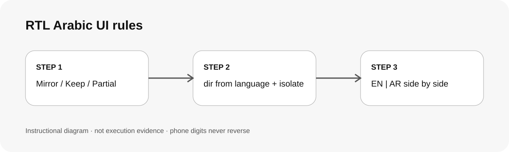

# 阿拉伯文 RTL 介面規則 / RTL Arabic UI rules

## 兩個好處 / Two benefits

用一個大型中東在地零售商的正式雙語網站當基準，直接知道哪些要轉、哪些不轉、哪些只轉外框，不必每個元件都重新爭論。電話、金額、時間與 email 有固定寫法與測試字串，最容易出錯的地方先擋下來。

Use a proven bilingual site of a very large Middle East retailer as the baseline, so each element is classified as mirror, keep or partial instead of being debated again. Phones, prices, times and emails get fixed patterns and test strings, catching the most common RTL defects first.

## 適用專案與階段 / Projects and stages

| 項目 / Item | 繁體中文 | English |
|---|---|---|
| 專案 / Projects | 中東市場的網站、App、電商、登入與結帳流程、設計系統 | Middle East websites, apps, e-commerce, login and checkout, design systems |
| 階段 / Stages | 設計稿、實作、交付前檢查、回歸 | Design, implementation, pre-delivery review, regression |

**流程示意圖，不是執行截圖或驗收結果。 / Instructional diagram, not an execution screenshot or acceptance result.**

**何時用 / When:** 做或檢查阿拉伯文畫面、EN/AR 雙語流程、海灣國家電話欄位時。 When designing or reviewing Arabic screens, EN/AR flows or GCC phone fields.

## 啟動前 / Before starting

確認 AI 已載入這個 skill 並回報 SKILL.md 路徑。準備同一畫面的英文與阿拉伯文版本（設計稿或可執行的頁面），以及要檢查的狀態清單。這是市場參考慣例，不是標準；品牌規範另有規定時以擁有者決定為準。

Confirm the agent loaded this skill and reports its SKILL.md path. Have the same screen in EN and AR (design frames or a running page) and the list of states to check. This is a market reference convention, not a standard; the owner's brand rules win.

## Step 1 → 2 → 3

### Step 1 · 分類 / Classify

逐個元件標成「轉／不轉／部分轉」，依 `references/rules.md`。不確定的列給擁有者決定。

Mark every element Mirror / Keep / Partial using `references/rules.md`; open questions go to the owner.

### Step 2 · 實作 / Implement

語言決定方向（不是國家），用 logical properties 與 `<bdi>`／`dir="ltr"` 隔離識別碼；電話依 `references/phone-numbers.md`。

Direction comes from the language, not the country; use logical properties and isolate identifiers; phones follow `references/phone-numbers.md`.

### Step 3 · 並排驗收 / Verify side by side

EN 與 AR 同狀態並排，跑 QA 清單與 bidi 測試字串，列出未執行的項目。

Compare EN and AR per state, run the QA checklist and bidi test strings, and list what was not run.

## 可直接貼給 AI / Copy this prompt

> 使用 rtl-arabic-ui 檢查這個登入頁的阿拉伯文版，特別是電話欄位。先列出每個元件「轉／不轉／部分轉」的表，再列修正與未驗項目。

> Use rtl-arabic-ui to review the Arabic version of this checkout. Classify every element as mirror / keep / partial, check the phone field, then list fixes and unverified items.

## 你會拿到 / Expected output

分類表、修正清單、EN／AR 並排證據、`+` 號慣例的決定（`971+` 或 `+971`）、未翻譯文字清單與未驗項目。

Classification table, fix list, EN/AR side-by-side evidence, the chosen `+` convention (`971+` or `+971`), untranslated-copy list and unverified items.

## 和其他 skill 合用 / Combine with others

搭配 ui-design-review 對照設計稿、states-preview-loop 巡各狀態、a11y-review 檢查 RTL 的焦點與朗讀順序。

Use ui-design-review for design comparison, states-preview-loop for state sweeps and a11y-review for RTL focus and reading order.

## 常見搭配平台 / Works well with

常見搭配：**Figma, React, Next.js, Vite, Codex, Claude Code**。這些名稱用來說明常見工作情境，不代表官方合作、內建 connector 或已完成整合。

Common workflow companions: **Figma, React, Next.js, Vite, Codex, Claude Code**. Names describe common use cases only; they do not imply endorsement, bundled integrations or verified connectivity.

## 自訂與選填 / Customize and optional

可指定 `+` 號慣例、是否使用東阿拉伯數字（٠١٢٣，預設不用）、要支援的國碼與驗證方式、哪些物件圖示要翻轉。

Choose the `+` convention, whether to use Eastern Arabic digits (default: no), supported country codes and validation, and which object icons to mirror.

## 結束與交接 / Finish and hand off

1. 交分類表與修正清單。 / Hand over the classification table and fixes.
2. 附 EN／AR 同狀態並排證據。 / Attach EN/AR evidence per state.
3. 記錄 `+` 號與數字慣例的決定。 / Record the `+` and digit decisions.
4. 列出未翻譯文字與未驗項目（裝置、瀏覽器、螢幕閱讀器、母語審稿）。 / List untranslated copy and unverified items (device, browser, screen reader, native review).

## 邊界 / Limits

規則來自單一正式網站的 EN/AR 並排比對，不是 Unicode 或任何標準；阿拉伯文文案需要母語者確認；各國號碼規則請以最新號碼計畫或 libphonenumber 為準。

Rules come from a side-by-side EN/AR review of one production site, not from a standard; Arabic copy needs a native reviewer; confirm numbering plans against current sources or libphonenumber.

[回到 skill 規則 / Skill instructions](../SKILL.md)

## 每步畫面 / Step pictures

v0.1 先提供流程圖。參考網站截圖不公開；實際 screenshots 需等 synthetic fixture 驗證後再補。

v0.1 starts with the workflow diagram. Reference-site screenshots are not published; add screenshots only after a synthetic-fixture validation.
