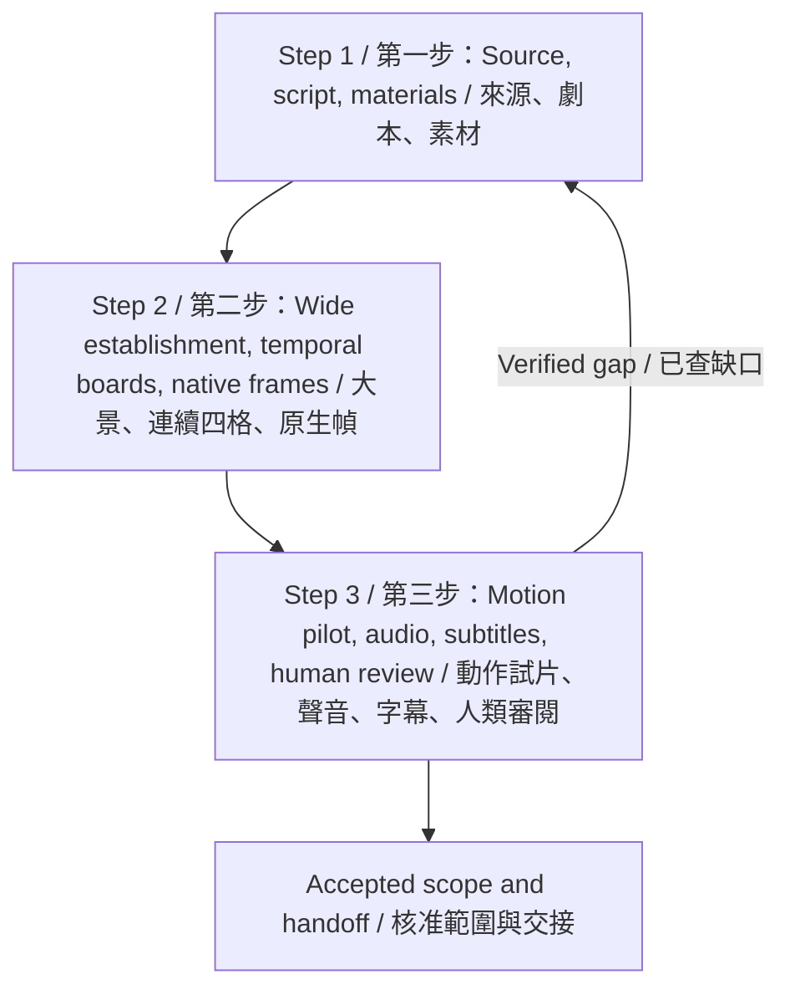

# Quick Start / 快速開始

This text-first guide uses a conceptual flow diagram. It does not depict an actual production run, generated film, or approval. Separate instructional image files are not included.

本版以文字指引與概念流程圖呈現，不是實際執行、生成影片或驗收紀錄；未附獨立教學圖檔。

## Two benefits / 兩項效益

1. Keep story, design, staging, sound, and actual outputs connected, so the next session can continue from evidence.
2. Reach a meaningful motion pilot early by filling necessary gaps without making unrelated missing assets a global barrier.

1. 串起劇本、造型、站位、聲音與實際產物，讓下一個 session 能直接接續。
2. 先補必要缺口、先做有效動作試片，不讓其他場缺項擋住全部製作。

## Projects and stages / 適用專案與階段

Use for filmed, animated, illustrated, or mixed-media projects during source adaptation, material preparation, storyboarding, audio and motion production, recovery, or final review. The linked [production records](production-records.md) describe useful fields; reuse the project's existing records when equivalent. Bind actual footage and takes when filming is the selected route rather than forcing a generation pipeline.

適用實拍、動畫、插畫或混合媒材影片的來源改編、素材準備、分鏡、聲音、動態製作、中斷恢復與最終驗收。[製作紀錄](production-records.md)提供欄位參考，已有等效紀錄就沿用。選實拍時綁實際素材與拍攝take，不強迫改走生成管線。

## Before starting / 開始前

Read the latest instructions, canonical source, `PLAN.md`, `HANDOFF.md`, accepted index, and execution receipts. Collect submitted results before retrying. Confirm this project's tool permissions, media rights, resource owner, attempt policy, and any existing schedule. Unknown values stay unknown.

先讀最新指示、權威原稿、`PLAN.md`、`HANDOFF.md`、已核素材索引及執行收據；已送工作先收結果。核本專案的工具授權、素材權利、資源承辦者、嘗試政策及既有排程，未知值保持未定。

## Step 1 / 第一步：Connect the story and materials / 接好劇本與素材

Keep canonical prose, the shooting script, and the executable shot breakdown distinct and connected. Write rich, varied, understandable prose without inventing source events or dialogue. For real stories, verify the formal title, author, version, synopsis, original passage, primary source, rights, causal adaptation, and film credit. Mark invented stories as invented.

Separate character identity, height and scale, and story-state tables. Bind each scene and panel's characters, periods, clothes, injuries, and emotions to exact reference versions, paths, hashes, and approval scopes. For every view, record requested and actual dimensions, native or upscaled origin, and effective face or body pixel coverage. Reuse existing assets and list only real gaps.

小說／正史、分場劇本、逐鏡分鏡分開並保留來源連結。文字豐富多變，也要白話可拍，不新增無來源事件或對白。真實故事查正式篇名、作者、版本、簡介、原文片段、第一手來源、權利、因果適配與影片出處；虛構篇名明說虛構。

人物本體、身高比例、劇情狀態分表。每場每格綁人物、期別、衣傷情緒及精確角色圖版本、路徑、SHA、核准範圍。每視角記請求與實際尺寸、原生或放大、臉或身體有效像素佔幅。沿用已有素材，只補真缺項。

For recurring file checks, run [inspect_assets.py](../scripts/inspect_assets.py) on a private external JSON manifest and read its compact summary. It checks existence, SHA-256, and PNG dimensions, not visual quality or native provenance. Exit codes are `0` basic file checks met, `1` findings/unverified format, and `2` input/report error. `--output` only creates a new report and refuses overwrites.

每輪重複檔案檢查可用 [inspect_assets.py](../scripts/inspect_assets.py) 讀專案私有JSON清單，再讀精簡摘要，避免反覆載入大ledger。只核存在、SHA及PNG尺寸，不代替實看或原生出處收據。回傳碼 `0` 是基本檔案檢查通過、`1` 是缺檔／低於目標／SHA不符／格式未核等問題、`2` 是輸入或報告錯誤；`--output`只建新報告，不覆檔。

## Step 2 / 第二步：Establish, board, and bind native frames / 大景、四格與原生幀

At every true new scene or sublocation, start with a distinct wide view of all present people, entrances and exits, fixed objects, body directions, gaze, and invariant spatial relationships. Preserve movement start and end positions across cuts. World direction and camera-relative screen direction remain separate.

Arrange consecutive character beats into four-panel groups and prepare independently generated native frames. Empty-scene camera comparisons, four seeds, and collage crops do not replace those outputs. A long scene can use several groups; do not invent extra actions to fill a grid.

每到真正的新場景或子空間，先獨立大景，交代全部當下人物、出入口、固定物、朝向視線與不可變關係。移動記起訖，換鏡不重置站位，世界方向與畫面左右分開。

四宮格安排連續人物節拍，再備各格原生獨立幀。空景四機位、四個seed、四格裁切不代替成果。長場可多組，不為湊格數捏造新動作。

## Step 3 / 第三步：Run a motion pilot and review sound / 動作試片與聲畫驗收

Complete the necessary inputs for one or two motion shots and execute a bounded pilot using authorized tools. Map the seventeen requirements to actual tool and output evidence. Do not hold still images to meet a character-motion requirement.

Record real audio duration and listening feedback. Keep dialogue, effects, music, and subtitles on separate tracks with a shared timebase. Watch and listen to the pilot, resolve its important failures, then expand within accepted scope.

先備一至兩鏡必要輸入，用已授權工具做有限動作試片。十七項逐鏡需求逐項連到實際能力與輸出，不以靜圖延長湊人物動作時長。

記實際音訊時長與試聽結果。配音、音效、配樂、字幕分軌共用時間線，實看實聽試片、解決重要失敗，再依核准範圍擴大。

## Expected output / 預期交付

Traceable source adoption, shooting script and shot breakdown; scoped character, scale, state and location materials; temporal boards and independent frames; real audio; an observed motion pilot; aligned sound and subtitles; and exact review and approval records. The final deliverable is the agreed reviewed film, not the inventory alone.

交付可追溯的來源採用、分場與逐鏡劇本，人物／比例／狀態／場景素材，時序四格及獨立幀、實際音訊、動作試片、對齊字幕聲畫與明確驗收紀錄。最終成果是約定審閱完成的影片，不是只有盤點表。

## Customize and optional / 調整與選用項

Use the project's own attempt limits, call spacing, resource checks, review stages, and schedule cadence. Optional turnarounds or training become dependencies only where the actual workflow needs them. If image size or effective detail is below the project target, report it honestly and rerender only within authorization. Two unsuccessful attempts with the same method require a changed strategy; an upscale or a whole character board does not substitute for a native single-view original. Do not install, download, pay, publish, create schedules, or delegate without the relevant existing permission.

採專案自己的嘗試額度、呼叫間隔、資源預檢、審閱階段與排程頻率。選用六視圖或訓練只在實際工作流依賴時保留，不加全片全員起跑門檻。尺寸或有效細節未達目標就明報，依現有授權重算；同法兩次未改善先改策略。放大檔與角色板總圖都不替代單視角原生原檔。安裝、下載、付費、發布、建排程與分工沿用現有授權。

## Finish and hand off / 完成與交接

Persist the source revision, actual outputs and hashes, review scope, unresolved items, active jobs, owner, and concrete next action. Quiet scheduled runs also update execution state. Two unchanged results trigger root-cause investigation and a changed strategy. Preserve an existing schedule's identifier and cadence; do not create one automatically.

Delegate only with authorization and disjoint scopes. Keep shared resource control and ledgers under one current writer. Complete the agreed human audiovisual review before declaring final acceptance.

留下來源版本、實際檔案與SHA、驗收範圍、未定項、執行中工作、承辦者與下一步。安靜排程也更新狀態；連兩次結果相同就查根因、改策略，保留既有ID與頻率，不自動新建排程。

已有授權才並行分工，檔案範圍互斥，共享資源與ledger單一當前承辦者。完成約定的人類聲畫審閱，再標最終通過。
